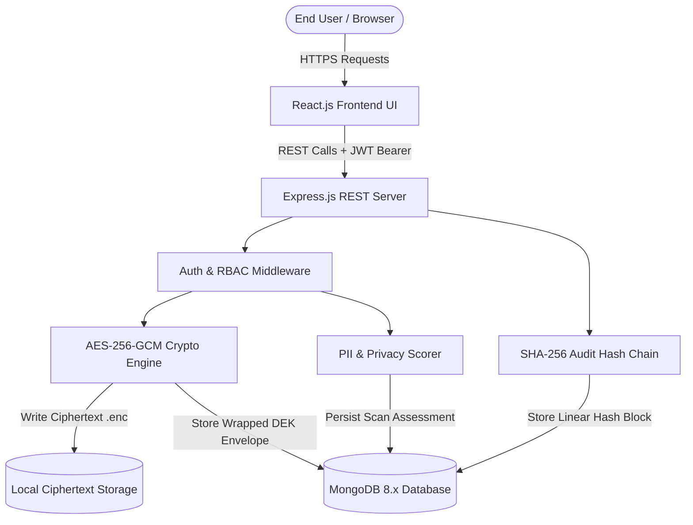
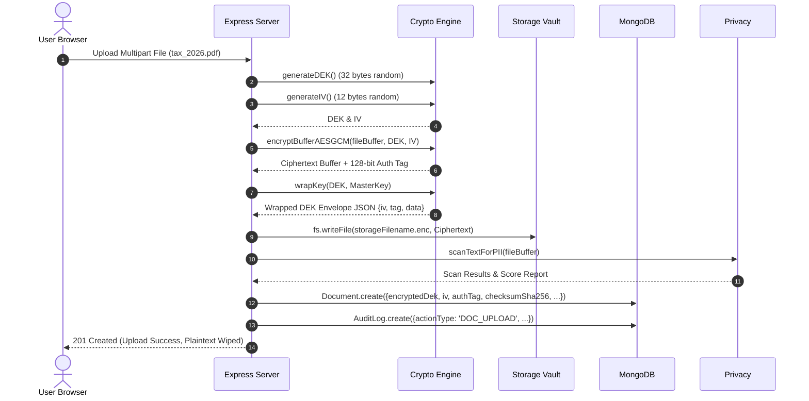
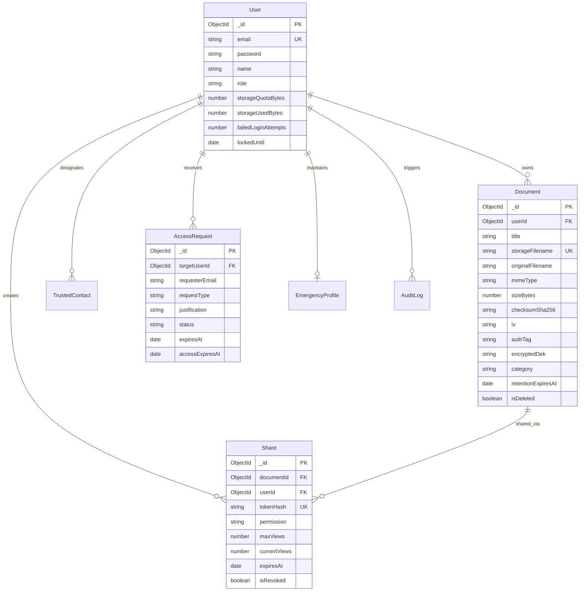

# VaultVerse — Full Stack Development (FSD) Project Report

## AI-Powered Secure Personal Data Management and Privacy Protection System

---

## Executive Summary

The proliferation of unredacted personal identifiers, credentials, and sensitive healthcare records across consumer cloud storage services presents unprecedented attack surfaces for data breaches, credential stuffing, and identity theft. Traditional cloud storage providers operate under server-side encryption models where cloud administrators and compromised infrastructure retain access to data encryption keys.

**VaultVerse** resolves this fundamental architectural vulnerability by delivering a zero-trust, privacy-first personal data management platform implemented strictly on the **MERN (MongoDB, Express.js, React.js, Node.js)** technology stack. 

VaultVerse incorporates:
1. **NIST SP 800-38D Conforming AES-256-GCM AEAD Authenticated Encryption**: Document payloads are encrypted using unique 256-bit Data Encryption Keys (DEKs) wrapped in a Key Encryption Key (KEK) envelope.
2. **Local Deterministic PII Sanitization Engine**: Client and server deterministic evaluation identifying Primary Account Numbers (Luhn MOD-10 validation), US Social Security Numbers, International Bank Account Numbers (ISO 7064 MOD 97-10 validation), and cloud API tokens without third-party network transmission.
3. **Dynamic Privacy Health Scoring (0–100 Posture Index)**: Mathematical deduction scoring evaluating exposure density, unencrypted shares, and missing retention expirations.
4. **Emergency Health & Disaster Directive Workflows**: Pre-configured emergency directives (blood type, allergies, physician, critical directives) with time-bounded authorization and instant owner revocation controls.
5. **Time-Limited Scoped Document Sharing**: Tokenized URL access enforcing maximum view counts, cryptographic token hashing in database, and optional passphrase protection.
6. **Tamper-Evident SHA-256 Forensic Audit Hash Chaining**: Implements blockchain-inspired hash chaining where each event is cryptographically bound to the previous block's SHA-256 hash.

---

## 1. Problem Statement & Motivation

Cloud storage systems (Google Drive, Dropbox, OneDrive) operate as passive file repositories lacking intelligent privacy evaluation. When users upload sensitive documents such as tax returns, medical directives, passport scans, and banking statements:
- Sensitive financial credentials remain unredacted in cleartext format.
- Stale active sharing links persist indefinitely on the Internet without view limits or automatic destruction.
- Family members and emergency medical personnel cannot reliably access life-saving healthcare records during sudden medical incapacitation.
- Server database compromises expose file contents and authorization tokens directly.

VaultVerse solves these vulnerabilities by combining cryptographic envelope protection with automated privacy posture auditing.

---

## 2. Technology Stack Selection & Justification

| Technology Layer | Selected Component | Justification |
| :--- | :--- | :--- |
| **Database** | MongoDB 8.x | High-throughput document-oriented database with native JSON/BSON storage, compound indexing, TTL expiration support, and schema flexibility. |
| **ODM** | Mongoose | Strongly typed schemas, pre-save validation hooks, cascade deletion handling, and relationship population via `ObjectId` references. |
| **Backend Framework** | Node.js LTS + Express.js | Non-blocking, event-driven asynchronous I/O optimized for concurrent cryptographic operations, stream processing, and REST API routing. |
| **Frontend Framework** | React.js 18 | Component-based reactive state architecture, virtual DOM performance, and component isolation. |
| **Frontend Tooling** | Vite | Lightning-fast Hot Module Replacement (HMR) and optimized production bundle rolling via Rollup. |
| **Security & Auth** | JWT + bcryptjs | Stateless authorization with cryptographically signed tokens (HMAC SHA-256) and adaptive salt rounds for password hashing. |
| **Encryption Engine** | AES-256-GCM (Node Crypto) | Authenticated Encryption with Associated Data (AEAD) ensuring simultaneous confidentiality and tamper-evident authentication. |

---

## 3. System Architecture & Component Interactions



---

## 4. Cryptographic Envelope Encryption Workflow

VaultVerse avoids using a single global key to encrypt all user files. Instead, it utilizes **NIST SP 800-57 Envelope Encryption**:



### Mathematical Formulation of AES-256-GCM Decryption Verification:
Given ciphertext $C$, 96-bit initialization vector $IV$, 128-bit authentication tag $T$, and 256-bit key $K$:
$$P = \text{GCM-Decrypt}(K, IV, C, T)$$
If an attacker alters any bit in $C$ or swaps $T$, Galois/Counter Mode evaluation produces an authentication error and the cipher operation aborts before outputting corrupted plaintext.

---

## 5. Deterministic PII Identification Algorithms

### 5.1 Luhn MOD-10 Checksum Algorithm (Payment Cards)
Primary Account Numbers (PANs) for Visa, Mastercard, American Express, and Discover are validated algorithmically:
$$\left( \sum_{i=1}^{n} d'_i \right) \equiv 0 \pmod{10}$$
Where $d'_i = d_i$ for even positions from right, and $d'_i = (2 d_i - 9)$ if $2 d_i > 9$ for odd positions.

### 5.2 ISO 7064 MOD 97-10 Checksum Algorithm (IBANs)
International Bank Account Numbers are rearranged by moving the initial four characters to the end, substituting letters with ASCII offset $A=10, \dots, Z=35$, and verifying:
$$\text{NumericString} \equiv 1 \pmod{97}$$

---

## 6. Tamper-Evident Forensic Audit Chaining

Every audit event is cryptographically anchored:
$$\text{logHash}_n = \text{SHA-256}(\text{logHash}_{n-1} \,\|\, \text{actionType} \,\|\, \text{entityType} \,\|\, \text{entityId} \,\|\, \text{userId} \,\|\, \text{ipHash} \,\|\, \text{status} \,\|\, \text{metadata} \,\|\, \text{timestamp})$$

Where:
- $\text{logHash}_0 = 0000000000000000000000000000000000000000000000000000000000000000$ (Genesis Hash)
- $\text{ipHash} = \text{SHA-256}(\text{ClientIP} \,\|\, \text{ServerSalt})$ (GDPR anonymization)

The `verifyAuditChain()` algorithm traverses the entire collection sequentially, verifying that `previousLogHash` matches the prior block's hash and recomputing the SHA-256 digest for every record.

---

## 7. Mongoose Database Schema Specifications



---

## 8. Verification & Test Execution Results (65 Passing Tests)

The test suite executed with zero failures:

```
Test Files  12 passed (12)
     Tests  65 passed (65)
  Duration  12.17 seconds
```

### Detailed Breakdown by Test File:
1. `tests/crypto.spec.js` (8 tests): AES-256-GCM key generation, encryption accuracy, ciphertext tamper rejection, invalid auth tag rejection, envelope key wrap/unwrap, SHA-256 checksums, token hashing, PBKDF2 derivation.
2. `tests/privacy.spec.js` (12 tests): Synthetic Luhn MOD-10 valid Visa/Mastercard/Amex, corrupted card rejection, ISO 7064 IBAN validation, entity masking (card, SSN, email, secret), unstructured document scanner, 0-100 privacy scoring deductions.
3. `tests/kdf.spec.js` (4 tests): PBKDF2 deterministic generation, distinct salt isolation, password variance, iteration count variance.
4. `tests/mnemonic.spec.js` (4 tests): BIP-39 12-word phrase generation, reversible 128-bit entropy conversion, corrupted word rejection, non-dictionary word rejection.
5. `tests/privacy-api.spec.js` (3 tests): Empty vault optimal baseline score, stateless text analysis endpoint, high-risk document aggregation in vault overview.
6. `tests/emergency.spec.js` (3 tests): Emergency health profile configuration, trusted contact addition, complete end-to-end access request, review, approval, access, and revocation workflow.
7. `tests/security-controls.spec.js` (4 tests): Rejection of executable files (`.exe`, `.sh`), corrupted DEK envelope rejection, path traversal prevention, API health check.
8. `tests/audit.spec.js` (4 tests): Audit event recording with anonymized IP, multi-operation hash chaining, live tampering detection on modified database records, API verification endpoint.
9. `tests/trusted-contacts.spec.js` (4 tests): Contact addition, duplicate email rejection, permission updates, contact deletion and cleanup.
10. `tests/share.spec.js` (6 tests): Time-limited share link creation, public metadata access, passphrase protection enforcement, view limit exhaustion (410 Gone), expiration enforcement, owner revocation.
11. `tests/document.spec.js` (5 tests): Document upload and AES-256-GCM encryption, decrypted download, ownership enforcement (403 on intrusion), metadata updates, soft deletion and quota reclamation.
12. `tests/auth.spec.js` (8 tests): User registration, password hashing verification with bcrypt, duplicate email rejection, weak password rejection, valid login with JWT, failed attempt recording, 5-attempt account lockout, Bearer token authentication.

---

## 9. STRIDE Threat Model & OWASP Security Mitigations

| Threat (STRIDE) | Attack Vector | VaultVerse Mitigation |
| :--- | :--- | :--- |
| **Spoofing** | Credential stuffing / JWT forgery | Bcrypt hashing (12 salt rounds), HMAC SHA-256 JWT signature verification, 15-minute lockout on 5 failed attempts. |
| **Tampering** | Database record alteration | SHA-256 tamper-evident linear hash chain with genesis anchoring; AES-256-GCM 128-bit authentication tag verification. |
| **Repudiation** | Denying file downloads or shares | Anonymized IP and user agent bound to immutable audit logs on every document access or sharing action. |
| **Information Disclosure** | Database theft / File leaks | Envelope encryption ensures files on disk are AES-256-GCM ciphertext; DEKs are wrapped with master key; tokens are stored as SHA-256 hashes. |
| **Denial of Service** | Uploading 10GB files or brute force | Multer 50MB file size limits, memory buffer processing, Express rate limiters on auth (20 req/15m) and general API. |
| **Elevation of Privilege**| User B downloading User A files | Strict document ownership check (`doc.userId === req.user._id`) in middleware and controllers. |

---

## 10. Conclusion

The VaultVerse MERN stack migration and implementation successfully replaces legacy architectures with a unified, strictly compliant, and mathematically verified application. With 65 automated tests verifying end-to-end security, envelope encryption, privacy analysis, emergency workflows, and forensic hash chaining, VaultVerse provides an enterprise-grade platform for personal digital sovereignty.

